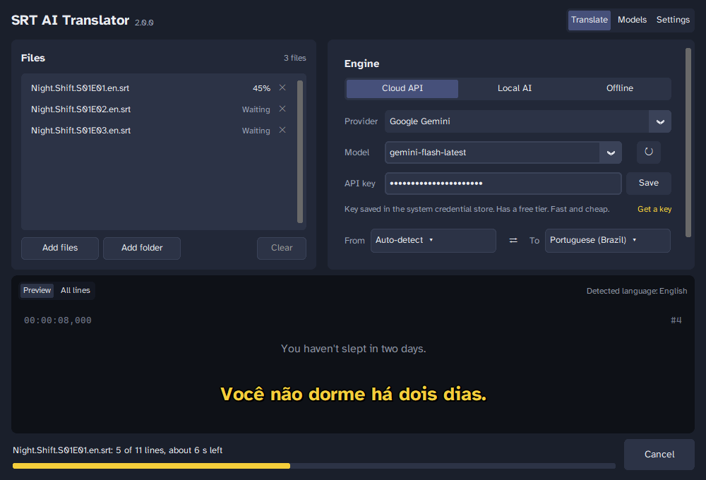
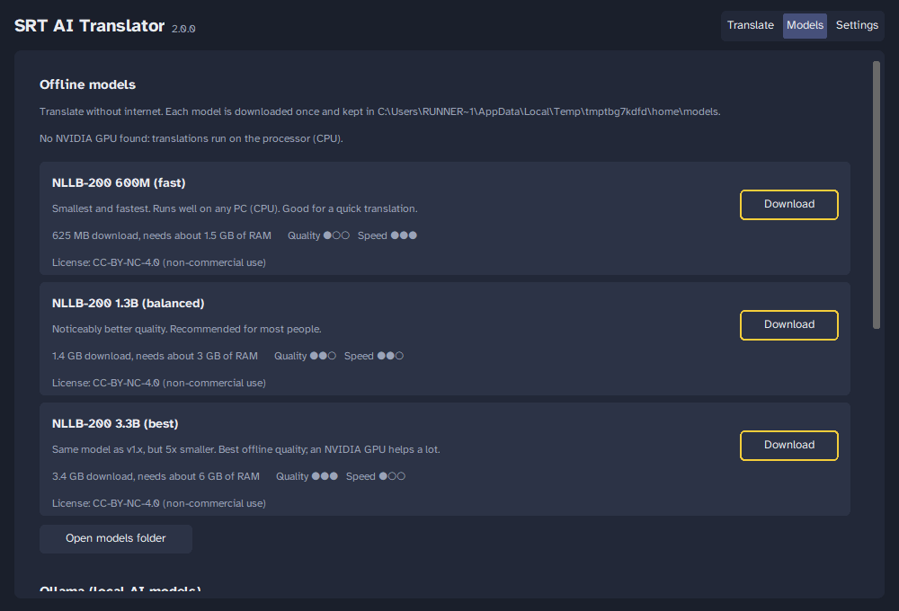
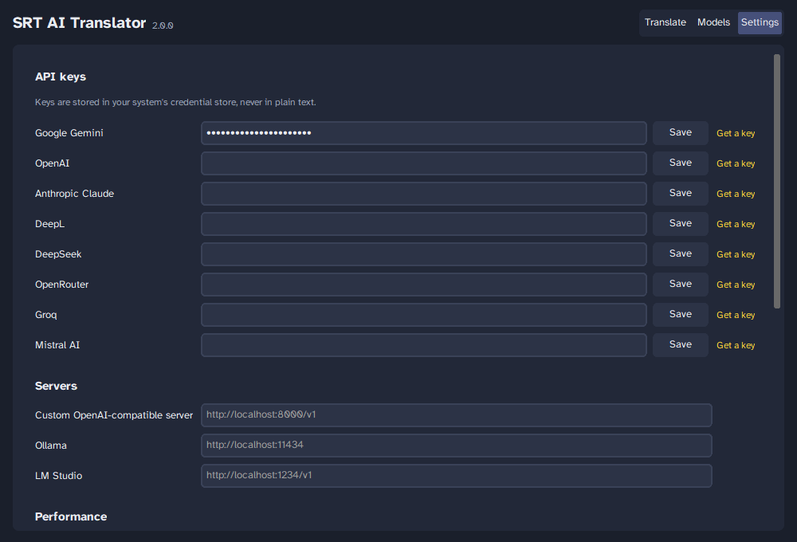

<p align="center">
  
</p>

# SRT AI Translator 2.0

Translate `.srt` subtitles into 80+ languages and regional variants with the engine you prefer: a cloud AI API, an AI model running on your own PC, or a built-in offline model. One `.exe` of about 50 MB, no installation, models downloaded only when you need them.

> **Em português:** veja o [guia rápido em português](#guia-rápido-em-português) no final.



<details>
<summary>More screenshots</summary>




</details>

## Features

- **Three ways to translate**
  - **Cloud API:** Google Gemini, OpenAI, Anthropic Claude, DeepL, DeepSeek, OpenRouter, Groq, Mistral, or any OpenAI-compatible server.
  - **Local AI:** [Ollama](https://ollama.com) (the app downloads the models for you, including Google's translation model *TranslateGemma*) or [LM Studio](https://lmstudio.ai).
  - **Offline:** Meta's NLLB-200 models (600M, 1.3B or 3.3B), downloaded once and then used without internet. Runs on any CPU; uses an NVIDIA GPU when available.
- **Subtitle-aware translation**
  - AI engines get the surrounding dialogue as context; every returned line is validated and missing lines are retried.
  - Sentences split across subtitles are translated as a whole by engines that have no context, then split back.
  - Keeps italics and other tags, `{\an8}` positions, dialogue dashes, music notes and sound descriptions.
  - Re-balances line breaks (42 characters per line by default).
  - Detects the source language and the file encoding automatically.
- **Practical**
  - Queue many files or whole folders, drag and drop, live preview of each translated line.
  - Saves `Movie.pt-BR.srt` next to the original, so video players load it automatically.
  - Translation memory: an interrupted job continues where it stopped, and repeated lines are never paid twice.
  - Glossary, notes about the video, formality, bilingual subtitles, removal of hearing-impaired notes.
  - API keys stored in the Windows Credential Manager (or your OS keychain), never in plain text.
  - Dark and light themes; English and Brazilian Portuguese interface.
  - Command line interface for batch jobs.

## Download

Get `SRTAI_Translator.exe` from the [latest release](https://github.com/MaloneFreak/SRTAITranslate/releases/latest) and run it. Nothing else to install.

> Windows may show "Windows protected your PC" because the file is not code-signed. Click **More info → Run anyway**. You can compare the file with the `.sha256` checksum published with each release.

## Which engine should I use?

| Engine | Cost | Internet | Quality | Good for |
|---|---|---|---|---|
| Google Gemini | Free tier, then cheap | Yes | Excellent | Most people: get a free key at [Google AI Studio](https://aistudio.google.com/apikey) |
| OpenAI / Claude / DeepSeek / Mistral | Paid per use | Yes | Excellent | If you already have a key |
| DeepL | Free plan: 500,000 characters/month | Yes | Very good | Fast, consistent translations of European languages |
| Ollama + TranslateGemma 4B | Free | Only to download (3.3 GB) | Very good | Privacy, no limits, a reasonably recent PC |
| Offline NLLB 600M / 1.3B / 3.3B | Free | Only to download (0.6 / 1.4 / 3.4 GB) | Good | No extra software, works on any PC |

A 45-minute episode has about 600 subtitles (roughly 25,000 characters), so a cloud API usually costs a few cents or less, and fits easily in free tiers.

## Quick start

1. Open the app and add your `.srt` files (button or drag and drop).
2. Pick an engine:
   - **Cloud API:** choose the provider, paste your API key and click **Save** (use **Get a key** to open the provider's page).
   - **Local AI:** install and open [Ollama](https://ollama.com/download), then download a model in the **Models** tab (`translategemma:4b` is a great start).
   - **Offline:** choose a model; it downloads automatically the first time (or download it in **Models**).
3. Choose the target language (the source is detected automatically) and click **Translate**.

The translated file is saved next to the original as `name.<language>.srt`. Click **Done** in the file list to show it in Explorer.

**Tips for AI engines:** under **More options**, describe the video in *Notes* (for example "crime drama, lots of slang") and list names in the *Glossary* (`Winterfell` to keep a name, `King's Landing = Porto Real` to force a translation).

## Command line

The same program can be used from a terminal:

```bash
# Python install
pip install -e .
srtai translate "Movie.en.srt" --to pt-BR --provider gemini
srtai translate ./Season1 --to es --provider offline --model nllb-1.3b
srtai translate film.srt --to de --provider ollama --model translategemma:4b --bilingual
srtai set-key gemini YOUR_KEY
srtai models download nllb-600m
srtai languages        # list language codes
srtai providers        # list engines

# Windows .exe
SRTAI_Translator.exe translate "Movie.en.srt" --to pt-BR --provider deepl
```

API keys can also come from environment variables such as `GEMINI_API_KEY`, `OPENAI_API_KEY`, `ANTHROPIC_API_KEY` or `DEEPL_API_KEY`.

## Where things are stored

- Settings, translation memory, logs and offline models: `%LOCALAPPDATA%\SRTAITranslate` on Windows (`~/.local/share/SRTAITranslate` on Linux).
- **Portable mode:** create a folder named `SRTAI_data` next to the `.exe`; everything is kept there instead.
- API keys: Windows Credential Manager / macOS Keychain / Secret Service.

**Privacy:** with cloud engines the subtitle text is sent to the provider you choose. Local AI and offline engines never send your subtitles anywhere.

## Run from source

Requires Python 3.10+ (3.12 recommended).

```bash
git clone https://github.com/MaloneFreak/SRTAITranslate.git
cd SRTAITranslate
python -m pip install -e ".[dev]"
python -m srtai            # opens the app (python SRTAI_Translator.py also works)
python -m pytest           # tests
python packaging/build.py  # builds dist/SRTAI_Translator.exe
```

Pushing a tag like `v2.0.0` makes GitHub Actions test the code, build the `.exe`, run its self-test and publish a release.

### Project layout

```
srtai/
  subtitles/   reading/writing SRT, tags, dialogue, line wrapping, sentence merging
  core/        translation pipeline, translation memory, language detection
  engines/     cloud APIs, Ollama/LM Studio, DeepL, offline CTranslate2
  models/      offline model catalog, resumable downloads, Ollama client
  gui/         CustomTkinter app (pages, widgets, theme, translations)
  cli.py       command line interface
tests/         pytest suite (mock API servers, a tiny offline model)
packaging/     PyInstaller spec and build scripts
```

## Troubleshooting

- **"Ollama isn't running":** install it from [ollama.com](https://ollama.com/download) and open it; it runs in the background (tray icon).
- **Offline engine is slow:** use the 600M or 1.3B model, or a PC with an NVIDIA GPU (CUDA 12 drivers and runtime). Without them it automatically uses the CPU.
- **Some lines stayed in the original language:** the engine could not translate them after several retries; the app tells you how many. Run the translation again; finished lines come from the translation memory.
- **Logs:** `srtai.log` in the data folder (Settings → Open data folder).

## Licenses

- Code: MIT (see [LICENSE](LICENSE)).
- NLLB-200 models (Meta): CC-BY-NC 4.0, non-commercial use.
- TranslateGemma and other Ollama models: their own licenses (shown on ollama.com).
- Interface font: Atkinson Hyperlegible (Braille Institute), SIL Open Font License.

## Contributing

Issues and pull requests are welcome. Please run `python -m pytest` before sending changes.

## Contact

- **Author:** Pedro Giácomo
- **GitHub:** [MaloneFreak](https://github.com/MaloneFreak)
- **Email:** malonefreak@yandex.ru

---

## Guia rápido em português

1. Baixe o `SRTAI_Translator.exe` na [última versão](https://github.com/MaloneFreak/SRTAITranslate/releases/latest) e abra. Não precisa instalar nada.
2. Adicione seus arquivos `.srt` (botão ou arrastando para a janela).
3. Escolha o motor de tradução:
   - **API na nuvem:** o Google Gemini tem plano gratuito. Pegue uma chave em [Google AI Studio](https://aistudio.google.com/apikey), cole no app e clique em **Salvar**.
   - **IA local:** instale o [Ollama](https://ollama.com/download) e baixe o `translategemma:4b` na aba **Modelos**. Funciona sem enviar suas legendas para ninguém.
   - **Offline:** escolha um modelo NLLB; ele é baixado automaticamente na primeira vez.
4. Escolha o idioma de destino (o de origem é detectado sozinho) e clique em **Traduzir**.

A legenda traduzida é salva ao lado da original como `Filme.pt-BR.srt`, e os players de vídeo já a reconhecem. O app pode ser usado em português: **Configurações → Idioma do app**.
